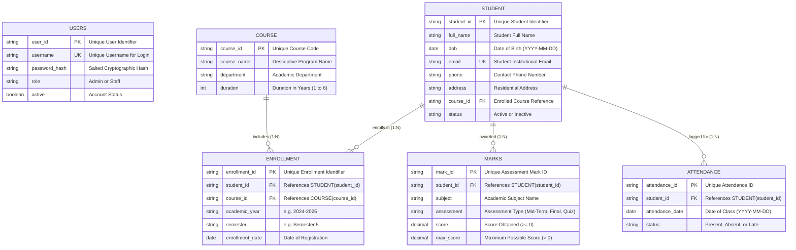

# Entity-Relationship (ER) Diagram & Data Dictionary

**Project:** Student Record Management System (SRMS)  
**Authors:** Shubham Gupta (Roll No: 45) & Swapnil Yadav (Roll No: 46)  
**Deliverable:** Deliverable #3 (ER Diagram & Entity Relationships)

---

## 1. Visual Entity-Relationship Diagram (Mermaid)



---

## 2. Cardinality & Relational Mappings

```
  +--------------+               1 : N              +------------------+
  |   STUDENT    | -------------------------------> |    ENROLLMENT    |
  +--------------+                                  +------------------+
         |                                                   ^
         | 1 : N                                             | N : 1
         v                                                   |
  +--------------+                                  +------------------+
  |    MARKS     |                                  |      COURSE      |
  +--------------+                                  +------------------+
         ^
         |
  +--------------+                                  +------------------+
  |  ATTENDANCE  | <--- (1 : N from STUDENT)        |      USERS       |
  +--------------+                                  +------------------+
```

### Relational Rules:
1. **STUDENT to ENROLLMENT (1 to Many):**
   - One student can be enrolled in multiple semesters/terms over their academic program.
   - An enrollment record belongs strictly to exactly one student.
2. **COURSE to ENROLLMENT (1 to Many):**
   - One course program can have many student enrollments across terms.
   - Each enrollment record references a valid course code in the catalog.
3. **STUDENT to MARKS (1 to Many):**
   - One student has multiple marks entries across various subjects and assessment periods.
   - Every mark entry is linked to an existing student ID.
4. **STUDENT to ATTENDANCE (1 to Many):**
   - Daily attendance records link to a specific student ID with timestamps and attendance states.
5. **USERS (Access Control):**
   - Independent entity maintaining administrator and faculty/staff authentication credentials and permission flags.
