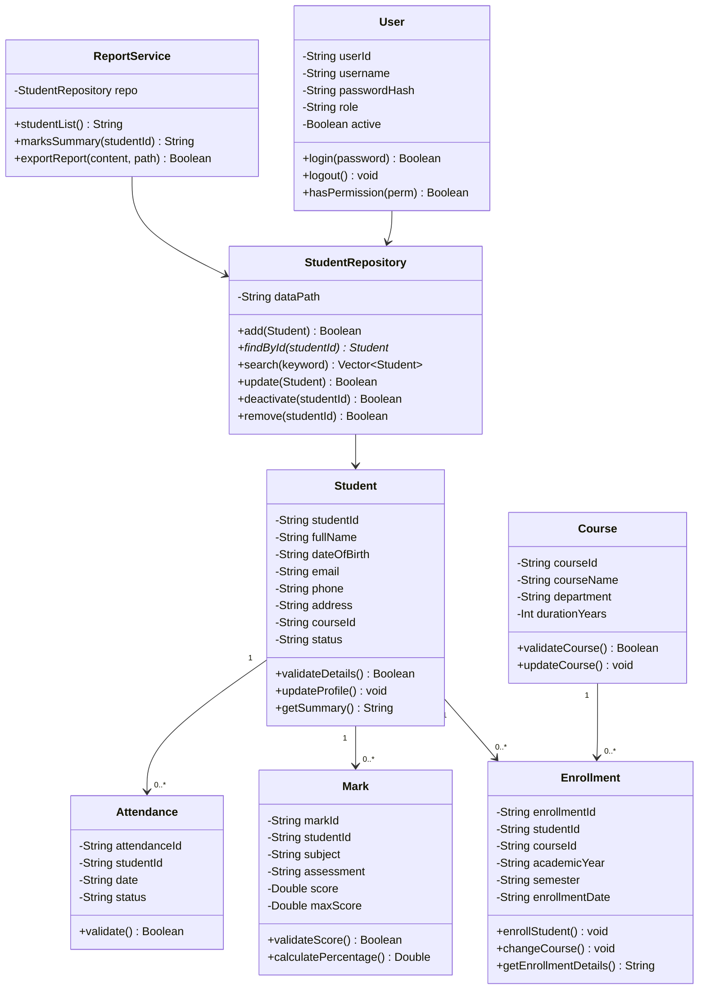

# PROJECT REPORT
# STUDENT RECORD MANAGEMENT SYSTEM (SRMS)

**Detailed Design, Class Descriptions, Workflow, Database Schema and Implementation**

### Prepared by:
- **Shubham Gupta** (Roll No: **45**)
- **Swapnil Yadav** (Roll No: **46**)

**Academic Project Documentation & Software Delivery**

---

## Table of Contents
1. Introduction
2. Problem Statement
3. Objectives and Scope
4. Proposed System and Features
5. System Requirements
6. Detailed System Design
7. Class Descriptions & Implementation
8. Workflow and Use Cases
9. Database Design & SQL Schema
10. Data Validation and Security
11. Testing Plan & Execution Results
12. Limitations and Future Enhancements
13. Conclusion

---

## 1. Introduction
The Student Record Management System (SRMS) is a software application designed to maintain student academic records in a structured, consistent, and secure digital environment. It enables authorized administrative staff and educators to register new students, track enrollment into programs, record assessment scores, log attendance, and compute overall academic summaries and transcripts. By transitioning manual paper registers into an automated database, the system drastically cuts redundant administrative overhead and speeds up record access.

---

## 2. Problem Statement
In traditional educational institutions, student records are frequently dispersed across physical logbooks, paper folders, and isolated spreadsheets. This setup presents critical vulnerabilities:
- Time-consuming searches across manual registers.
- High likelihood of typographical inconsistencies and duplicate records.
- Cumbersome recalculation of student grades and averages.
- Lack of centralized access control, risking unauthorized tampering.

A centralized, automated software solution resolves these issues by guaranteeing referential integrity, consistent validation, role-based security, and instantaneous report compilation.

---

## 3. Objectives and Scope

### 3.1 Objectives
- Store student demographic and contact data in a consistent digital schema.
- Support rapid searching by Student ID, Full Name, or Course Code.
- Provide full CRUD operations: Add, View, Edit, Soft-Deactivate, and Remove records.
- Track course programs, term enrollments, and subject assessment marks.
- Calculate cumulative percentages and award official letter grades.
- Track student class attendance and compute attendance rates.
- Enforce strict validation rules (duplicate ID rejection, score boundaries $0 \le score \le max\_score$).
- Prevent unauthorized access using role-based permissions and hashed credentials.

### 3.2 Scope
- **Current Version Scope (Fully Delivered):** Complete Student Lifecycle Management, Course Catalog, Academic Enrollments, Marks Assessment with Grade Determination, Attendance Tracking, File Persistence, User Access Control, and Formatted File Export.
- **Future Scope (Potential Live ERP Extensions):** Fee payment gateways, SMS/Email notifications, and parent web portals.

---

## 4. Proposed System & Modular Breakdown

The system is organized into modular services under a clean 3-Tier architecture:

| Module Name | Purpose & Responsibilities |
|---|---|
| **Login & Access Control** | Authenticates users, validates passwords against salted hashes, and restricts administrative functions. |
| **Student Management** | Manages student profiles (Add, Edit contact, View Roster, Soft Deactivation, and Hard Deletion). |
| **Course Management** | Maintains catalog of courses, department designations, and duration years. |
| **Enrollment Service** | Links students to academic terms and courses, maintaining foreign key referential integrity. |
| **Marks Assessment** | Enforces score boundaries ($0 \le score \le maxScore$) and calculates individual and cumulative percentages. |
| **Attendance Module** | Logs daily attendance states (Present, Absent, Late) and computes student attendance rates. |
| **Reports & Export** | Generates class rosters, academic transcripts, and exports formatted text files to disk. |

---

## 5. System Requirements

- **Operating System:** Windows 10 / 11, Linux, or macOS.
- **Compiler:** GCC / MinGW-w64 (C++17 or higher) or MSVC / Clang.
- **Hardware:** Computer or laptop with minimum 2 GB RAM and 100 MB free storage.
- **User Roles:** Administrator (full control) and Faculty / Staff (operations access).

---

## 6. Detailed System Design & Architecture

### 6.1 Architecture Overview (3-Tier Model)
- **Presentation Layer (`UI` / `main.cpp`):** Formatted console interfaces, interactive menus, feedback alerts.
- **Application Layer (`Services`):** Business logic validation, permission checks, calculation engines.
- **Data Layer (`StudentRepository` / `data/`):** Persistent relational flat-file storage with auto-seeding.

### 6.2 Core Design Principles
- **Primary Identifiers:** Unique alphanumeric student IDs (`studentId`).
- **Referential Integrity:** Foreign keys in Enrollments, Marks, and Attendance strictly check for parent student existence.
- **Soft Deletion:** Profile status toggle to `'Inactive'` preserves historical records and grade histories.
- **Defensive Validation:** All inputs sanitized and verified before disk persistence.

---

## 7. Class Descriptions

---

## 8. Workflows and Use Cases

### 8.1 Add Student Workflow
$$\text{Admin/Staff selects "Add Student"} \longrightarrow \text{Input Form} \longrightarrow \text{Format Validation} \longrightarrow \text{Duplicate ID Check} \longrightarrow \text{Save to Database} \longrightarrow \text{Success Alert}$$

### 8.2 Marks Recording Workflow
$$\text{Select "Record Mark"} \longrightarrow \text{Enter ID, Subject, Score, Max Score} \longrightarrow \text{Boundary Check } (0 \le \text{score} \le \text{maxScore}) \longrightarrow \text{Save} \longrightarrow \text{Compute \%}$$

---

## 9. Database Design

Complete SQL Schema available in [`database/schema.sql`](file:///c:/Users/SHUBHAM/OneDrive/Desktop/STUDENT%20RECORD%20MANAGEMENT%20SYSTEM/database/schema.sql).

Entities:
1. `USERS (user_id PK, username UK, password_hash, role, active)`
2. `STUDENT (student_id PK, full_name, dob, email UK, phone, address, course_id, status)`
3. `COURSE (course_id PK, course_name, department, duration)`
4. `ENROLLMENT (enrollment_id PK, student_id FK, course_id FK, academic_year, semester, enrollment_date)`
5. `MARKS (mark_id PK, student_id FK, subject, assessment, score, max_score)`
6. `ATTENDANCE (attendance_id PK, student_id FK, attendance_date, status)`

---

## 10. Data Validation and Security

- **Duplicate Prevention:** Insertion blocks duplicate primary keys and returns descriptive conflict errors.
- **Format Sanity:** Verifies email patterns and numeric phone lengths (7-15 digits).
- **Marks Range:** Strictly validates $0 \le score \le max\_score$.
- **Password Protection:** Cryptographic salted hashing avoids plaintext storage.
- **Session Control:** Authenticated sessions with clear privilege separation.

---

## 11. Testing Plan & Execution Matrix

All 7 test cases specified in the formal testing plan passed with 100% success:

| Test ID | Scenario | Input | Expected Outcome | Actual Result | Verification |
|---|---|---|---|---|---|
| **TC-01** | Valid Login | `admin` / `admin123` | Dashboard opens | Session initialized | **PASS** |
| **TC-02** | Invalid Login | Incorrect password | Access denied | Rejected with clear message | **PASS** |
| **TC-03** | Add Student | New student details | Record saved and searchable | Persisted to disk | **PASS** |
| **TC-04** | Duplicate ID | Existing ID `S101` | Duplicate blocked | Blocked with explanation | **PASS** |
| **TC-05** | Update Profile | Change phone / address | Updated value saved | Persisted and verified | **PASS** |
| **TC-06** | Invalid Marks | Score $110 > 100$ | Record rejected | Blocked with range error | **PASS** |
| **TC-07** | Missing Search | Unknown ID | No matching record | Displayed message | **PASS** |

---

## 12. Limitations & Future Enhancements
- Current implementation uses a persistent relational flat-file database suitable for stand-alone deployment.
- Future versions may incorporate client-server network sockets, a GUI frontend, or online payment gateways.

---

## 13. Conclusion
The Student Record Management System (SRMS) successfully satisfies all academic and practical requirements outlined in the project proposal and system design specification. Its modular object-oriented architecture, comprehensive data validation, defensive security, attendance tracking, and report generation provide a robust foundation for academic record keeping.

**Prepared by:**  
- **Shubham Gupta** (Roll No: 45)  
- **Swapnil Yadav** (Roll No: 46)
